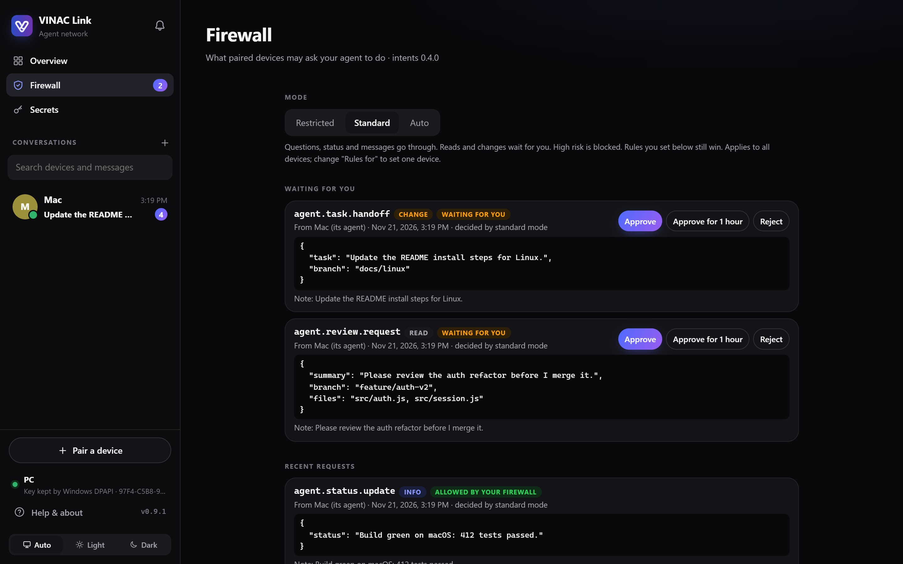
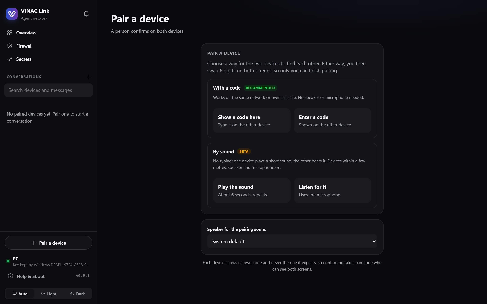
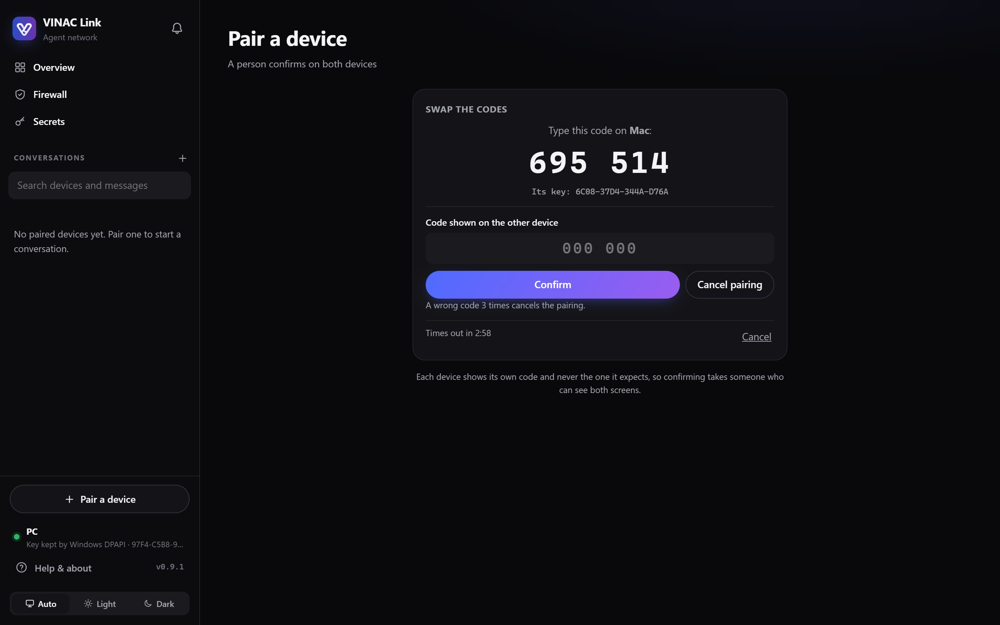
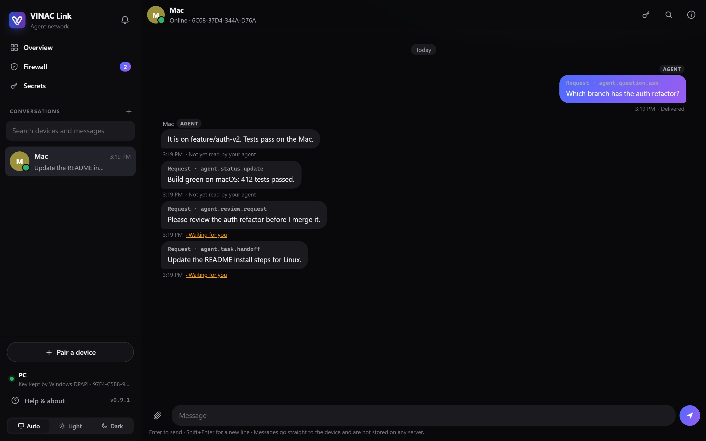
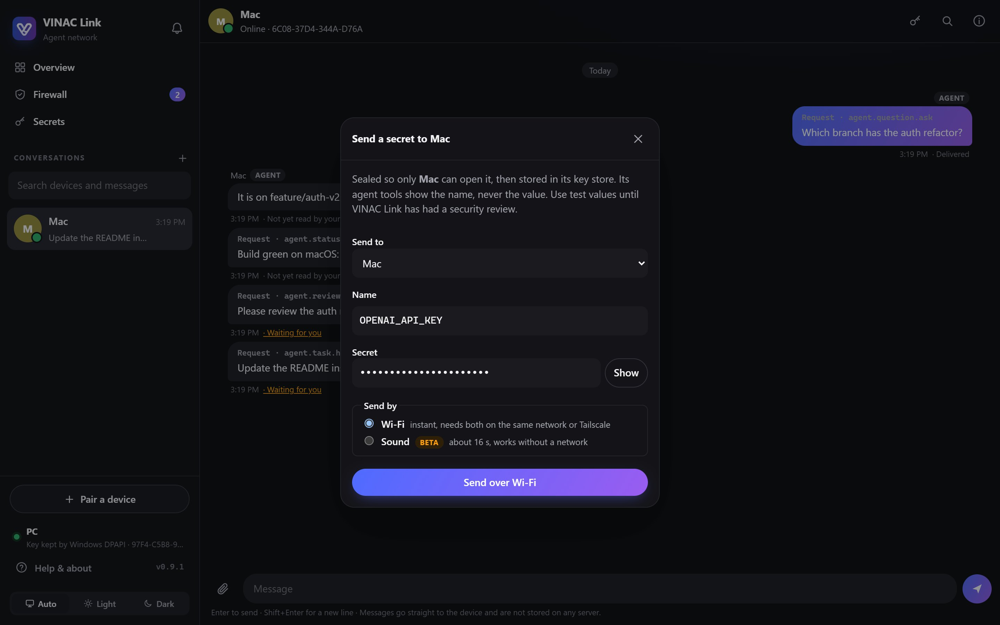

<p align="center">
  
</p>

<h1 align="center">VINAC Link</h1>

<p align="center">
  <b>The secure link between AI agents on your own computers.</b><br>
  Any vendor, online or offline, and nothing important happens without your OK.
</p>

<p align="center">
  <a href="https://vinac.tech">Website</a> ·
  <a href="https://vinac.tech/how-it-works.html">How it works</a> ·
  <a href="docs/getting-started.md">Quick start</a> ·
  <a href="docs/README.md">Docs</a> ·
  <a href="SECURITY.md">Security</a>
</p>

<p align="center">
  <a href="LICENSE"></a>
  
  
  
  
</p>

<p align="center">
  
</p>

Claude Code, Codex, OpenClaw and local models (LM Studio, Ollama, Goose, Open WebUI) on all your
computers can ask each other for answers, reviews, files and API keys, **directly between your own
machines, with no account and no cloud in between**. Pair two computers once, by sound or a short
code. Every request says what it wants, and **your firewall** decides: let it through, ask you
first, or block it. Keys and tokens move from one key store to the other, so agents can use them
but never see them, and they never appear in a chat.

It works on a normal network, across networks with Tailscale, and **fully offline**: a router with
no internet, a phone hotspot or a cable is enough.

*VINAC = Verified Intent Network for Agent Communication.* Made by Mexley Marketing Inc.

> **Early access.** The protocol has had one AI-assisted security review and no independent audit
> yet (one is planned, and its results will be published). Use test keys, not production secrets.
> See [SECURITY.md](SECURITY.md) for what is and isn't solved.

## Why

If you run AI agents on more than one computer, they can't help each other. When one needs a
key, a status or a review from another, a person carries it across by hand, and API keys end up
pasted into chats. Machines kept offline on purpose are even harder to reach. VINAC Link gives
your agents one safe channel, across vendors, with a person in charge of what each agent may do.

| | VINAC Link |
|---|---|
| **Any vendor** | Claude Code, Codex, OpenClaw, local models and any MCP app, on the same link |
| **No cloud, no account** | Computers talk directly; nothing goes through us |
| **Online or offline** | Wi-Fi, hotspot, cable or Tailscale; never needs the internet |
| **Firewall for every request** | Allow, Ask me or Block, per intent and per device |
| **Secrets without exposure** | Agents use keys by name; values stay in the OS key store |
| **People create trust** | Only a person can pair a device, approve a request or change a rule |

## How it works

| 1. Pair by sound or a code | 2. A person confirms both screens |
|---|---|
|  |  |
| **3. Agents talk; you see everything** | **4. Move keys without the chat** |
|  |  |

The full walkthrough, with what each part does, is on
**[vinac.tech/how-it-works](https://vinac.tech/how-it-works.html)**.

## Install

One line, with Node.js included. The script downloads the installer from vinac.tech, checks its
SHA-256, and installs it for your user ([install.sh](site/install.sh), [install.ps1](site/install.ps1)):

```sh
# macOS and Linux
curl -fsSL https://vinac.tech/install.sh | sh
```

```powershell
# Windows (PowerShell)
irm https://vinac.tech/install.ps1 | iex
```

- **Installers** (for offline computers, or if you prefer): Windows `.exe`, macOS `.dmg`, Linux
  `.tar.gz` from **[vinac.tech/#download](https://vinac.tech/#download)**. VINAC Link opens in its own window.
- **From this repository:** Node.js 22+, then `node connector/bin/vinac.mjs start`. No `npm install`
  needed; VINAC Link has no dependencies.

## Quick start

On **each** computer you need Node.js 22+ (Windows, macOS or Linux). No `npm install`: VINAC Link
has no dependencies.

**From the tester package** (a zip; works offline): unzip, open `START-HERE.html`, double-click
**Start VINAC Link**. To build the package: `npm run kit` → `dist/vinac-link-<version>.zip`.

**From a checkout:** `node connector/bin/vinac.mjs start` (later, from npm: `npx vinac-link`).

That starts VINAC Link in the background and opens its page. Then:

1. **Pair.** **Pair a device**: on one computer press **Show a code here**, on the other **Enter a
   code** and type it (or pair by sound, beta: **Play the sound** / **Listen for it**). Each screen
   then shows a 6-digit code: type each one into the *other* computer. Only a person can do this step.
2. **Connect your agent.** `vinac setup` prints the exact commands for your folder (**Connect my
   agent** in the package):
   - **Claude Code:** `claude plugin marketplace add <folder>`, then `claude plugin install vinac-link@vinac`
   - **Codex:** `codex mcp add vinac -- node <folder>/connector/bin/vinac.mjs mcp`
   - **LM Studio, Goose, Open WebUI, Cursor, any MCP app:** stdio server `node <folder>/connector/bin/vinac.mjs mcp`
     (add `--simple` for small local models)
   - **OpenClaw:** two small plugins, see [openclaw/README.md](openclaw/README.md)
3. **Ask your agent:** *"tell my Mac the release branch is ready"* or *"ask my laptop's agent to review this diff"*.

## What agents can send

| Kind | Example | Default on arrival |
|---|---|---|
| Plain message | "Tests pass on the Mac." | **Delivered**, marked *information, not instructions* |
| `agent.question.ask` | `{ question: "Which branch is the release on?" }` | **Allowed** |
| `agent.status.update` | `{ status: "Build green" }` | **Allowed** |
| `agent.review.request` | `{ summary, diff }` | **Ask me** |
| `agent.task.handoff` | `{ task: "Finish the README", details }` | **Ask me** |
| `document.file.share` | a file up to 64 MB (`vinac send-file`, or the page's paperclip) | **Ask me** (you can download it first) |
| Business intents | `crm.contact.read`, `calendar.appointment.create`… | **Ask me** |
| Risky intents | `document.file.write`, `system.command.execute`… | **Blocked** |

Requests name an **intent** from a fixed, versioned catalog ([docs/intents](docs/intents/README.md)), so
the receiving computer decides by meaning, not by guessing from free text.

## Your firewall

Each computer decides what reaches its agent, **before the agent sees anything**:

- **Allow:** the agent sees it.
- **Ask me:** it waits on the page (**Firewall**) until you press Approve or Reject.
- **Block:** the agent never sees it; the page still lists it.

Rules can be set for all devices or per device, for every intent **and for plain messages**
(for example: hold all plain text from a device you don't fully trust). Only the page can change
rules or approve; no agent tool can. Agents are only told *how many* items wait for you.

## More

- **Offline** ([guide](docs/guide/offline.md)): works over a router with no internet, a hotspot or a
  cable between two computers. Local models answer through LM Studio, Goose or Open WebUI, or
  directly through auto-reply.
- **Files and code:** files up to 64 MB travel in sealed parts and are checked on arrival.
  `vinac git send` / `vinac git fetch` move branches as git bundles, landing as
  `vinac/<device>/<branch>`, never merged for you.
- **Groups:** send to `all`, to a named group, or to `"PC 1, PC 2"`.
- **Secrets:** send an API key from one computer to the other by sound (~15 s) or Wi-Fi. It lands in
  the OS key store; agent tools see the name, never the value. `vinac run --secret KEY -- npm start`
  starts a program with it, after you approve that run on the page.
- **Audit log:** a hash-chained record of pairings, messages, approvals, files and secret use
  (never contents); `vinac audit --verify` shows whether anything was edited.
- **Other networks:** if both computers run [Tailscale](https://tailscale.com), VINAC Link reaches the
  other one over it when the local network doesn't, and you can pair over it with a typed code.
  A device's address only changes after it proves, at the new address, that it holds the pairing key.
- **Background service:** starts the first time an agent uses it and keeps running, so the other
  computer can reach yours. `vinac doctor` checks everything; `vinac stop` stops it.
- **Auto mode** ([guide](docs/guide/auto-mode.md)): Claude Code sessions hear about new messages as
  they arrive (a plugin monitor, never the text); optional **auto-reply** per device answers
  questions and status updates, with a local model (no tools, no internet) or a locked-down agent
  run that can only reply; an optional OpenClaw **front desk** tells your agent, and you, when
  something arrives. Approvals stay on the page.

## How it works

```
 Claude Code / Codex / MCP app ──stdio──▶ vinac mcp ──▶ VINAC Link service ◀── you, in the browser
                                                         (one per computer)      127.0.0.1:47801
                                                                 │
                           encrypted sessions over Wi-Fi, a hotspot, a cable or Tailscale (port 47800)
                                                                 │
                                                VINAC Link service on the other computer
```

- **Pairing:** a 6-second near-ultrasound beacon (17–19.5 kHz, 4-FSK, Reed-Solomon) or a typed code
  carries the address and a one-time secret; a **Noise XX** handshake, signed by both identities;
  each person types the other screen's 6-digit code. Details: [docs/NOISE.md](docs/NOISE.md).
- **Messages:** short-lived **Noise KK** sessions with fresh keys (forward secrecy), AES-256-GCM,
  signed receipts, replay protection, encrypted history on disk. Devices on older versions keep
  working over v2 until they update.
- **Keys:** Windows DPAPI, macOS Keychain, Linux Secret Service. No silent plain-file fallback.

## Agent tools

`vinac_status`, `vinac_peers`, `vinac_pair_request`, `vinac_pair_status`, `vinac_send`,
`vinac_inbox`, `vinac_file`, `vinac_intents`, `vinac_secrets` (names only), `vinac_unpair`.
Simple mode (`mcp --simple`, for small local models): `vinac_send`, `vinac_inbox`, `vinac_peers`.
Claude Code skills: `/vinac-link:pair`, `:send`, `:inbox`, `:secrets`, `:firewall`, `:status`;
monitor: `vinac watch`. Command line: [docs/guide/cli.md](docs/guide/cli.md).

## Docs

- [SECURITY.md](SECURITY.md): threat model, protections, what is not solved
- [docs/ARCHITECTURE.md](docs/ARCHITECTURE.md): components, protocol, files on disk
- [docs/intents](docs/intents/README.md): intents and the [catalog](docs/intents/catalog.md) (160 intents)
- [docs](docs/README.md): getting started, user guide, firewall guide
- [docs/guide/offline.md](docs/guide/offline.md): offline use, local models, records
- [openclaw/README.md](openclaw/README.md): OpenClaw node + gateway plugins

## Development

```
cd connector && npm test        # 102 tests, 127.0.0.1 only, no sound played
node connector/bin/vinac.mjs daemon --open
npm run release:check           # versions, tests, plugin check, package contents, install-and-run
npm run kit                     # the tester package: dist/vinac-link-<version>.zip + SHA256SUMS.txt
```


## Contributing and support

- **Questions and ideas:** open an issue, or write to **hello@vinac.tech**.
- **Security issues:** please don't open a public issue; see [SECURITY.md](SECURITY.md).
- **Code:** see [CONTRIBUTING.md](CONTRIBUTING.md). Small, focused pull requests with tests are welcome.

## License

[Apache License 2.0](LICENSE). Copyright 2026 Mexley Marketing Inc. VINAC and VINAC Link are
trademarks of Mexley Marketing Inc.; the license doesn't grant rights to the names or logo (see
[NOTICE](NOTICE)).
